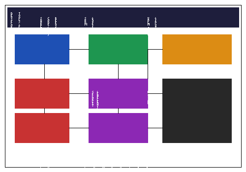

# DevSecOps-Kit

> A working engineer's devops and devsecops reference for vulnerability scanning, secret detection, SBOMs, supply chain security, runtime security, policy engines, infrastructure automation, and observability.

   

> **New here? Start at [the learning path](00_index/learning-path.md).** It walks you from first-contact to confident in a sensible order — read that before this table.

## Who this is for

A working devops and devsecops engineer's quick-reference: first-contact notes, runnable snippets, and configs for the tools you reach for every day. Use it as a shelf you grab from, not a tutorial site. It deliberately does not try to replace each tool's official docs.

## What's in here

Scope runs from Linux and Git fundamentals up through infrastructure as code and Kubernetes delivery, then into the security tooling that rides on top of it. Cross-cutting layers hold concept primers, how-to guides, runbooks, shell toolkits, cheatsheets, and starter templates that the per-tool folders lean on. Every entry is written to be adapted for real infrastructure work rather than read end to end.

## Quick links

- [GitHub Actions — run my first workflow and record what happened](github-actions/notes/2026-10-14-run-first-workflow.md) — Push-triggered run from queued to green, plus the silent-folder and indentation gotchas
- [Following the Helm quickstart — what tripped me up](helm/notes/2026-09-21-quickstart-tripped-me-up.md) — Chart install, values overrides, and the first release gotchas
- [My first Snyk test](snyk/scripts/2026-10-20-first-snyk-test.sh) — Dependency scan against a small project, from install to first finding
- [My first ggshield scan](gitguardian/scripts/2026-10-20-first-ggshield-scan.sh) — Pre-commit secret scan wired into a real repo
- [My first Nuclei template](nuclei/configs/2026-10-15-minimal-scan-template.yaml) — A single harmless word-matcher check at severity info for a practice page

## Layout

- **`00_index/`** — Navigation: topic map, quick links, glossary, learning path
- **`docs/`** — Concepts, how-to guides, reference, runbooks, security docs, troubleshooting, setup guides, and `docs/notes/`
- **`scripts/`** — Shell toolkits organised by domain (`scripts/bash/`), deployment and rollback wrappers (`scripts/pipeline/`), and repository utilities, plus `scripts/notes/` and `scripts/snippets/`
- **`snippets/`** — Copy-paste ready cheatsheets and one-liners, plus `snippets/configs/`, `snippets/notes/`, and `snippets/snippets/`
- **`templates/`** — Starter configs for Kubernetes, Terraform, Linux, Jenkins, Logstash, syslog-ng, and per-tool scaffolds, plus `templates/configs/`, `templates/notes/`, and `templates/templates/`
- **`environments/`** — Terraform environment configs (dev / staging / prod)
- **`lab/`** — Mini-projects and learning sandboxes
- **`assets/`** — Architecture diagrams and workflow illustrations
- **`.github/`** — CODEOWNERS, PR template, and Dependabot config

## Architecture Overview

Per-tool content folders follow a consistent shape — `notes/`, `scripts/`, `configs/`, `snippets/`, plus wherever useful `docs/`, `manifests/`, `dockerfiles/`, `notebooks/`, `policies/`, or `templates/`:

Trivy, Nuclei, Semgrep, Checkov, tfsec, Terrascan, Grype, Syft, TruffleHog, Gitleaks, GitGuardian, Snyk, Terraform, CodeQL, ZAP, Cosign, Falco, Tetragon, OPA, Vault, Ansible, ArgoCD, Dependabot, Docker, Git, GitHub Actions, Helm, Kubernetes, Kustomize, OpenTofu, Prometheus, Grafana, DefectDojo, SonarQube, Linux, Assets, and Lab.

## Coverage

Coverage table

| Tool | Notes | Docs | Scripts | Configs | Snippets | Templates | Manifests | Dockerfiles | Notebooks | Policies | Total | Last verified |
|------|------:|-----:|--------:|--------:|---------:|----------:|----------:|------------:|----------:|----------:|----------:|---------------|
| checkov | 4 | 6 | 4 | 3 | 4 | 16 | 3 | 0 | 4 | 1 | 45 | 2026-09-17 |
| syft | 4 | 8 | 4 | 1 | 2 | 13 | 4 | 1 | 4 | 0 | 41 | 2026-10-10 |
| trufflehog | 4 | 4 | 3 | 2 | 3 | 18 | 2 | 1 | 3 | 0 | 40 | 2026-10-13 |
| trivy | 8 | 6 | 6 | 3 | 1 | 10 | 2 | 1 | 2 | 0 | 39 | 2026-10-19 |
| zap | 6 | 5 | 3 | 3 | 4 | 7 | 1 | 1 | 1 | 0 | 31 | 2026-10-14 |
| codeql | 4 | 4 | 1 | 1 | 5 | 7 | 3 | 1 | 2 | 0 | 28 | 2026-10-08 |
| opa | 3 | 4 | 2 | 2 | 4 | 8 | 4 | 0 | 1 | 0 | 28 | 2026-10-06 |
| snyk | 5 | 4 | 2 | 3 | 1 | 10 | 1 | 1 | 1 | 0 | 28 | 2026-10-08 |
| ansible | 3 | 1 | 4 | 3 | 1 | 15 | 0 | 0 | 0 | 0 | 27 | 2026-10-15 |
| gitguardian | 5 | 4 | 4 | 3 | 2 | 8 | 0 | 0 | 1 | 0 | 27 | 2026-10-14 |
| grype | 5 | 3 | 8 | 2 | 2 | 0 | 2 | 1 | 2 | 0 | 25 | 2026-10-14 |
| semgrep | 3 | 8 | 3 | 1 | 2 | 0 | 3 | 2 | 3 | 0 | 25 | 2026-10-18 |
| falco | 5 | 4 | 3 | 4 | 1 | 4 | 1 | 0 | 2 | 0 | 24 | 2026-10-15 |
| terraform | 3 | 1 | 4 | 6 | 1 | 0 | 0 | 0 | 0 | 0 | 22 | 2026-08-10 |
| terrascan | 5 | 3 | 2 | 2 | 2 | 6 | 1 | 0 | 1 | 0 | 22 | 2026-10-10 |
| vault | 4 | 3 | 4 | 3 | 2 | 0 | 2 | 1 | 2 | 0 | 21 | 2026-08-30 |
| cosign | 5 | 3 | 3 | 2 | 1 | 0 | 2 | 2 | 1 | 0 | 19 | 2026-10-14 |
| dependabot | 7 | 4 | 2 | 5 | 0 | 0 | 0 | 0 | 1 | 0 | 19 | 2026-10-14 |
| docker | 2 | 2 | 3 | 1 | 0 | 7 | 1 | 2 | 0 | 0 | 18 | 2026-09-23 |
| github-actions | 7 | 0 | 0 | 6 | 3 | 0 | 2 | 0 | 0 | 0 | 18 | 2026-10-20 |
| argocd | 6 | 2 | 0 | 2 | 0 | 0 | 3 | 0 | 0 | 0 | 13 | 2026-09-23 |
| tetragon | 3 | 1 | 3 | 4 | 0 | 0 | 0 | 0 | 0 | 0 | 11 | 2026-09-26 |
| git | 3 | 1 | 4 | 1 | 1 | 0 | 0 | 0 | 0 | 0 | 10 | 2026-09-22 |
| kubernetes | 3 | 1 | 0 | 2 | 0 | 0 | 3 | 0 | 0 | 0 | 9 | 2026-10-14 |
| defectdojo | 4 | 0 | 1 | 1 | 2 | 0 | 0 | 0 | 0 | 0 | 8 | 2026-10-19 |
| grafana | 4 | 0 | 0 | 2 | 1 | 0 | 0 | 0 | 0 | 0 | 7 | 2026-10-14 |
| gitleaks | 3 | 0 | 2 | 1 | 0 | 0 | 0 | 0 | 0 | 0 | 6 | 2026-10-07 |
| helm | 4 | 0 | 0 | 0 | 0 | 0 | 2 | 0 | 0 | 0 | 6 | 2026-10-20 |
| kustomize | 3 | 0 | 0 | 2 | 0 | 0 | 1 | 0 | 0 | 0 | 6 | 2026-09-21 |
| linux | 3 | 1 | 1 | 1 | 0 | 0 | 0 | 0 | 0 | 0 | 6 | 2026-10-02 |
| opentofu | 3 | 0 | 0 | 3 | 0 | 0 | 0 | 0 | 0 | 0 | 6 | 2026-09-21 |
| sonarqube | 3 | 0 | 1 | 1 | 1 | 0 | 0 | 0 | 0 | 0 | 6 | 2026-09-21 |
| nuclei | 3 | 0 | 1 | 1 | 0 | 0 | 0 | 0 | 0 | 0 | 5 | 2026-10-15 |
| tfsec | 3 | 0 | 1 | 1 | 0 | 0 | 0 | 0 | 0 | 0 | 5 | 2026-10-19 |
| prometheus | 4 | 0 | 0 | 0 | 0 | 0 | 0 | 0 | 0 | 0 | 4 | 2026-10-14 |

_Counts are the files inside each category folder; a few folders also hold files at their root or in project sub-folders (Terraform's EventBridge sample, Lab's mini-projects, Environments' dev/staging/prod Terraform, and Assets' diagrams), which the category columns don't itemise. `Last verified` is the most recent `last_verified` marker anywhere in that tool's files._

## Status

First-contact notes are still landing where the kit was thin: a Nuclei quickstart pass with a first hand-written scan template, a Falco install mapped out against a box with no nodes to watch, a first Cosign signing command, and a first GitHub Actions run from queued to green. The thinner corners are still the tools carrying notes only: tfsec, and Nuclei until that first template actually runs.

---

_Last updated: 2026-10-20_
